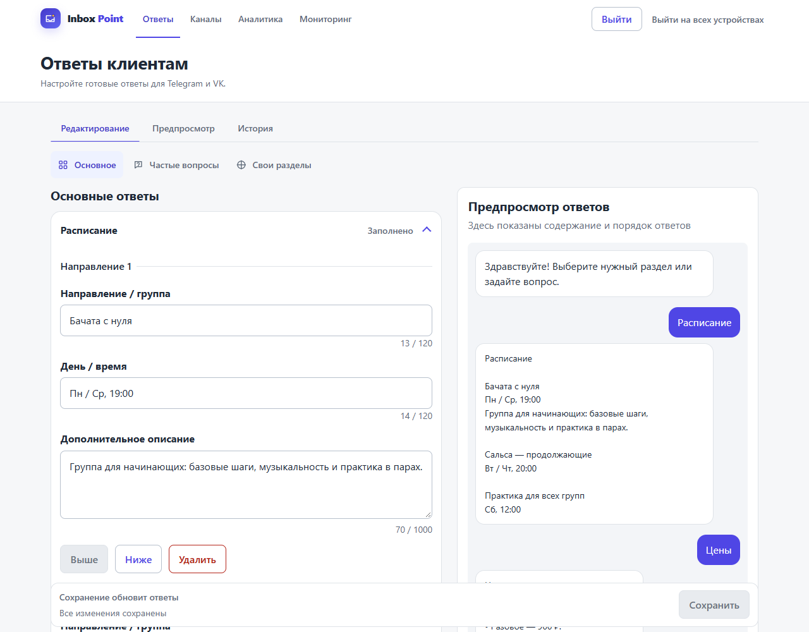

# Inbox Point

Self-hosted customer messaging for Telegram and VK. Customers stay in their messenger; staff reply in a private Telegram group with a topic for each customer. The browser interface is in Russian.

## Available workflows

- Prepared information: schedules, prices, addresses, FAQs and custom menu sections.
- Directions and class groups, meeting times, enrollment availability and a question for an application. Staff can confirm a class application from Telegram.
- Text questions and staff replies, closing requests and starting a new request in the existing customer topic.
- React content editor with preview, revision history, restore and recovery of unsaved edits.
- Channel setup, delivery diagnostics, pause/resume and an emergency browser inbox.
- Usage analytics for 7, 30 or 90 days, with Telegram/VK filters.

Closed enrollment offers a question about the group. It does not accept an enrollment application. Attachments and voice messages are not relayed as supported customer text. Answers come from prepared content or staff; AI-generated replies are not implemented.



## Run locally

Install JDK 25 and npm 11. Use the frontend toolchain version pinned in [`.nvmrc`](.nvmrc).

```sh
npm ci
npm run dev
```

Open [channel setup](http://127.0.0.1:3000/setup), [content](http://127.0.0.1:3000/manage), [analytics](http://127.0.0.1:3000/analytics) or [operations](http://127.0.0.1:3000/ops). Development uses local access rules; production requires the configured administrator password and HTTPS.

## Deployment and development

One instance serves one organization, with its own SQLite database and adjacent settings. See the [deployment guide](deploy/README.md) for isolation, backup and updates.

```sh
npm run check
npm run check:e2e
```

The application uses Java 25, Spring Boot and SQLite on the server, with React, React Router and TanStack Query in the browser. The backend is in `backend/` and the frontend is in `frontend/src/`.

[MIT License](LICENSE)
