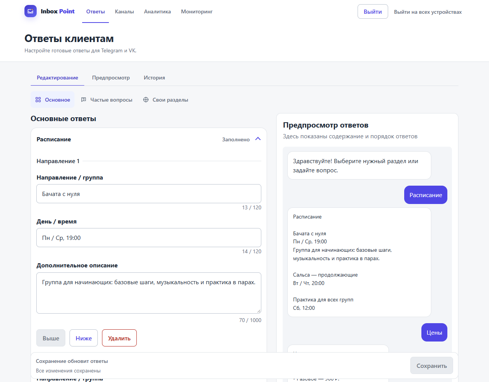

# Inbox Point

Inbox Point helps your team answer customer messages from Telegram and VK in one
private Telegram group. Customers keep using their usual messenger.

You install it on your own server.



## How it works

1. A customer writes to your Telegram bot or VK community.
2. They can browse information you have prepared, such as prices or opening hours.
3. If they need help, their question appears in your team's Telegram group,
   in a separate topic for that customer.
4. Your team replies there, and the customer receives the answer in the same
   conversation where they asked.

## What you can do

- Answer text messages from Telegram and VK in one place.
- Edit schedules, prices, addresses, and common answers in a browser.
- Preview answers before saving and return to earlier versions.
- See messages that could not be delivered and retry sending them.
- Use a backup inbox in the browser when your team cannot use Telegram.

Only text messages are supported for now. Customers who send attachments or voice
messages are asked to write their question as text. Replies use information you
prepare or messages from your team; there are no AI-generated answers.

The interface is in Russian. The screenshot shows example data.

## Run locally

Requires Node.js 24.20.x and npm 11.

```bash
npm ci
npm run dev
```

Open [channel setup](http://127.0.0.1:3000/setup) to connect Telegram or VK,
then use the menu to edit customer information or check messages.

For server installation, passwords, and backups, follow the
[setup guide](deploy/README.md). Server setup requires technical experience.

## Built with

TypeScript, Node.js, React, and SQLite.

## License

[MIT](LICENSE)
